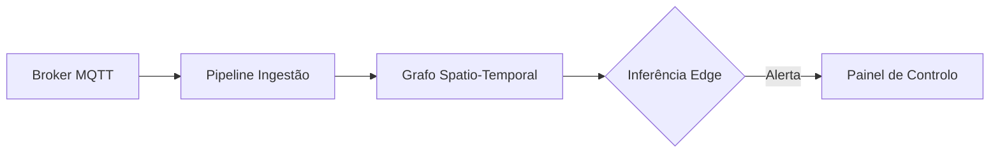

# Cheat Sheet de Sintaxe Slidev & Markdown

Guia de referência rápida dos blocos e funcionalidades mais úteis do Slidev para apresentações técnicas e académicas.

---

## 1. Separação de Diapositivos e Transições

```markdown
---
transition: slide-left
---
```
Três traços `---` delimitam cada novo diapositivo. Pode definir transições personalizadas (`slide-left`, `fade`, `slide-up`, etc.).

---

## 2. Layouts Nativos de Colunas

### Colunas Padrão (`two-cols`)
```markdown
---
layout: two-cols
---

# Lado Esquerdo
Texto da primeira coluna.

::right::

# Lado Direito
Texto da segunda coluna.
```

### Controlo de Largura Flexível com Tailwind CSS
```html
<div class="grid grid-cols-5 gap-6">
  <div class="col-span-3">Coluna 60%</div>
  <div class="col-span-2">Coluna 40%</div>
</div>
```

---

## 3. Animações e Revelação Progressiva (`v-clicks`)

Revele itens sequencialmente com o comando do teclado (barra de espaços ou seta para a direita):

```markdown
<v-clicks>

- Ponto revelado no primeiro clique
- Ponto revelado no segundo clique
- Ponto revelado no terceiro clique

</v-clicks>
```

Para aplicar a um único elemento:
```html
<p v-click>Este parágrafo só surge após um clique.</p>
```

---

## 4. Blocos de Código com Destaque de Linhas (Shiki)

```python {all|2|4-6}
def calcular_metricas(dados):
    # Destaque dinâmico de linhas
    f1 = avaliar_f1(dados)
    if f1 > 0.90:
        return "Aprovado para Produção"
    return "Em Ajuste"
```

---

## 5. Fórmulas Matemáticas (KaTeX Integrado)

- **Fórmula inline:** `$E = mc^2$`
- **Bloco de equação destacado:**
```latex
$$
\text{MAE} = \frac{1}{n} \sum_{i=1}^n |y_i - \hat{y}_i|
$$
```

---

## 6. Diagramas Mermaid Nativos



---

## 7. Notas de Orador (Speaker Notes)

Adicione notas no fim do slide que só surgem no Presenter Mode (prima a tecla `P` no navegador):

```markdown
<!-- SLIDE CONTENT AQUI -->

<!-- Notas de orador que não aparecem no ecrã público: -->
<!--
- Enfatizar a métrica de 34% de redução
- Lembrar que os dados foram validados pelo orientador
- Fazer a ponte para o slide seguinte
-->
```
