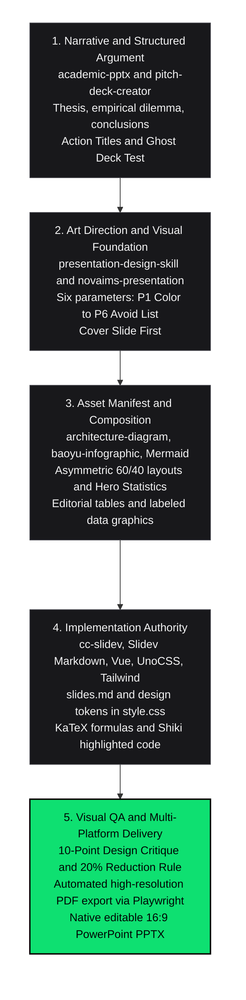

# 🎓 Academic & Technical Presentation Creation Suite

> An end-to-end engineered workflow for drafting rigorous academic papers, technical reports, and crafting high-impact presentations using **Slidev**, **Tailwind CSS**, and **native PowerPoint**. Built to replace generic AI slop with deliberate editorial art direction and structured arguments.

[](LICENSE)
[](https://sli.dev)
[](#nova-ims-brand-regulations)
[](#native-powerpoint-workflow)

---

## 📌 Overview 

Most academic and corporate presentations fail at two distinct points:
1. **The Argument Problem:** Copying entire paragraphs onto slides, using generic topic labels (*"Introduction"*, *"Results"*), and losing audience attention in wall-to-wall text.
2. **The Aesthetic Problem ("AI-Slop"):** Generating generic AI templates loaded with blurred purple gradients, centered card grids, identical pill badges, and irrelevant stock icons.

This suite enforces an **opinionated, engineered presentation pipeline**. It bridges deep scientific writing and mathematical reasoning with modern editorial design, typography discipline, and reproducible code-driven slide rendering.

---


## ⚙️ The Orchestrated Workflow Pipeline

We do not design slides by opening a blank GUI editor. Every deck follows a strict multi-tier orchestration pipeline:




---

## 🧠 Integrated Skill Stack & Responsibilities

The ecosystem divides responsibilities across specialized, composable authorities:

| Skill1                               | Role & Scope                                    | Core Deliverables                                                                                                                                                             |
| ------------------------------------ | ----------------------------------------------- | ----------------------------------------------------------------------------------------------------------------------------------------------------------------------------- |
| **`academic-pptx`**                  | **Narrative Authority (Scientific & Academic)** | Evidence-first argumentation, slide timing budget (90s rule), academic QA, ghost deck validation, literature positioning.                                                     |
| **`pitch-deck-creator`**             | **Narrative Authority (Product & Pitch)**       | Problem-solution framing, value proposition, traction metrics, market sizing, call-to-action dynamics.                                                                        |
| **`presentation-design-skill`**      | **Art Direction Authority**                     | Creative direction, 6 Parameters (P1–P6), 9 slide layout archetypes, typographic hierarchy, editorial anti-pattern elimination.                                               |
| **`novaims-presentation`**           | **Brand Compliance Authority**                  | Official NOVA IMS regulations: brand colors (`#0EE071`, `#3777FF`, `#000000`), contrast rule (black text on green backgrounds), Swiza/Borna typefaces, official logo margins. |
| **`cc-slidev`**                      | **Implementation Authority**                    | Fast developer server, Slidev Markdown orchestration, responsive Vue layouts, local headless rendering, PDF/PPTX export pipelines.                                            |
| **`architecture-diagram` & Visuals** | **Visual Asset Authority**                      | Flat, clean technical diagrams via Mermaid, KaTeX equations, and SVG illustrations without unnecessary decoration.                                                            |

---

## 📐 Design System & Editorial Rules

### 1. The 6 Presentation Parameters (P1–P6)
- **P1: Color Foundation (60-25-10-5 Rule):** 60% dominant canvas (deep dark `#000000` or crisp `#FFFFFF`), 25% secondary surfaces/cards (`#111111`), 10% high-contrast typography (`#FFFFFF` or `#18181B`), and strictly 5% functional accent.
- **P2: Typography Pairing:** Display Face with tight tracking (`-0.03em`) at 48px–72px for titles; clean, highly legible Sans (Inter, Borna, Arial) at 16px–20px for body text. Maximum 3–5 lines per text block.
- **P3: The Accent Job:** The accent color (e.g. `#0EE071`) has **one single job** across the whole deck (e.g. *Highlight primary metric or winner only*). When accent does everything, it highlights nothing.
- **P4: Signature Motif:** A subtle, consistent recurring structure (e.g., editorial 4px left-border rule on cards, technical metadata footers).
- **P5: Charts & Tables:** 100% 2D flat design. No vertical gridlines, no 3D distortion. Labels are placed directly on the data points.
- **P6: Avoid List:** Zero blurry gradients, zero rounded badge pills without purpose, zero generic sci-fi/AI icons, zero centered walls of text.

### 2. Action Titles & The Ghost Deck Test
Every slide title is a **complete sentence declaring a factual conclusion or finding**, not a passive topic label:
- ❌ *Weak:* `"Traffic Congestion in Lisbon"`
- ✅ *Strong:* `"Centralised routing generates 22 minutes of peak-hour delay across major corridors"`

**The Ghost Deck Test:** Read only the slide titles in sequence. If they do not communicate the complete, persuasive reasoning of the project from start to finish without looking at the body, the structure must be rewritten before designing slides.

### 3. The 20% Reduction Rule
Before approving any slide, remove 20% of its visual clutter (extra decorative rules, redundant labels, background containers). If the core message remains equally clear or sharper, keep the elements removed. Deliberate whitespace conveys analytical authority.

---

## 🗂️ Repository Structure

```text
.
├── README.md                              # Complete workflow, skill map, and usage guide
├── 01_academic_foundations/               # Research & paper drafting foundations
│   ├── 01_estrutura_trabalhos_academicos.md  # Standard thesis/paper structure
│   ├── 02_template_relatorio_academico.md    # Ready-to-use academic report template
│   └── 03_metodologia_argumentacao_estruturada.md # Action titles & Ghost Deck methodology
│
├── 02_art_direction_and_design/           # Design principles & institutional standards
│   ├── 01_framework_design_6p.md             # The 6 Parameters (P1-P6) design system
│   ├── 02_arquetipos_de_slides.md            # The 9 visual layout archetypes
│   ├── 03_anti_ai_slop_guidelines.md         # Diagnostic table & 20% reduction rule
│   └── 04_brand_guidelines_novaims.md        # Official NOVA IMS brand kit regulations
│
├── 03_slidev_starter_template/            # Production-ready Slidev engine
│   ├── slides.md                             # 7-slide reference deck (benchmarks, hero metrics)
│   ├── style.css                             # Custom design tokens, dark cards & tables
│   ├── package.json                          # Slidev & Playwright tooling
│   └── public/                               # High-resolution logos (SVG/PNG)
│       ├── ims_logo_negativo.svg
│       ├── ims_logo_positivo.svg
│       └── ims_logo_negativo.png
│
├── 04_scripts_and_automation/             # Automation, local preview, and exporters
│   ├── setup.sh                              # One-command dependency installer
│   ├── preview.sh                            # Local dev server with hot-module reload
│   ├── export_deck.sh                        # Headless export to PDF & PPTX
│   └── build_native_pptx.py                  # Standalone Python generator for native 16:9 PPTX
│
└── 05_checklists_and_cheat_sheets/        # Fast QA checklists & developer cheat sheets
    ├── checklist_apresentacao_academica.md   # Content, timing (90s), and data QA
    ├── checklist_critica_design_10p.md       # 10-point visual design critique
    └── cheat_sheet_slidev_markdown.md        # Slidev syntax, two-cols, KaTeX & Shiki
```

---

## 🚀 Quick Start Guide

### Prerequisites
- **Node.js** (v18+) & **npm**
- **Python 3.10+** (with [uv](https://github.com/astral-sh/uv) recommended)

### 1. Installation
Clone the repository and run the setup script:
```bash
git clone https://github.com/your-username/presentation-suite.git
cd presentation-suite/04_scripts_and_automation
./setup.sh
```

### 2. Live Slidev Development
Launch the local Slidev development server with hot-reload:
```bash
./preview.sh
# Server opens automatically at http://localhost:3030
```

### 3. Build & Export (PDF & PPTX)
Export the presentation to high-resolution PDF and PowerPoint slides:
```bash
./export_deck.sh
```
Exports are saved directly in `03_slidev_starter_template/dist_exports/`.

---

## 📊 Native PowerPoint Workflow (Without Node.js)

If a team member or stakeholder requires a 100% native, fully editable `.pptx` file without running Node.js or Playwright:

```bash
# Using uv (isolated, zero dependency pollution):
uv run --with python-pptx 04_scripts_and_automation/build_native_pptx.py my_deck.pptx

# Or standard Python:
pip install python-pptx
python3 04_scripts_and_automation/build_native_pptx.py my_deck.pptx
```

The script builds high-contrast, master-aligned 16:9 cards, metric callouts, and institutional headers directly via the OpenXML PowerPoint engine.

---

## 🏛️ NOVA IMS Brand Regulations

When building presentations for **NOVA Information Management School**:
- **Primary Colors:** Black (`#000000`), White (`#FFFFFF`), NOVA IMS Green (`#0EE071`), and Blue (`#3777FF`).
- **Green Contrast Rule:** Whenever an element or slide uses `#0EE071` as its background, **all typography and icons MUST be pure Black (`#000000`)**. White text over NOVA IMS green violates contrast compliance.
- **Institutional Signature:** Bottom-right footer displays `NOVA IMS. DATA WITH PURPOSE`.
- **Logos:** Use `ims_logo_negativo.svg` for dark backgrounds and `ims_logo_positivo.svg` for white/light layouts.

---

## 📄 License

This project is licensed under the [MIT License](LICENSE).
Built with by **Adriano Vilhena** and **Agy** (Hermes Coding Agent).
